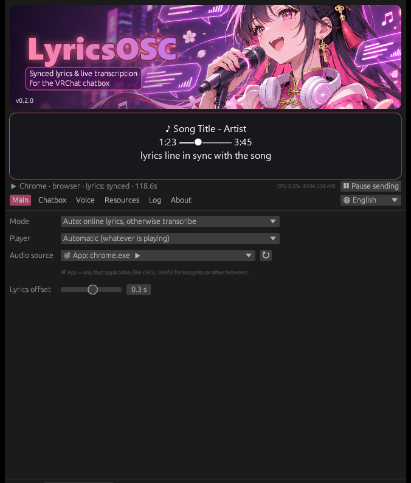
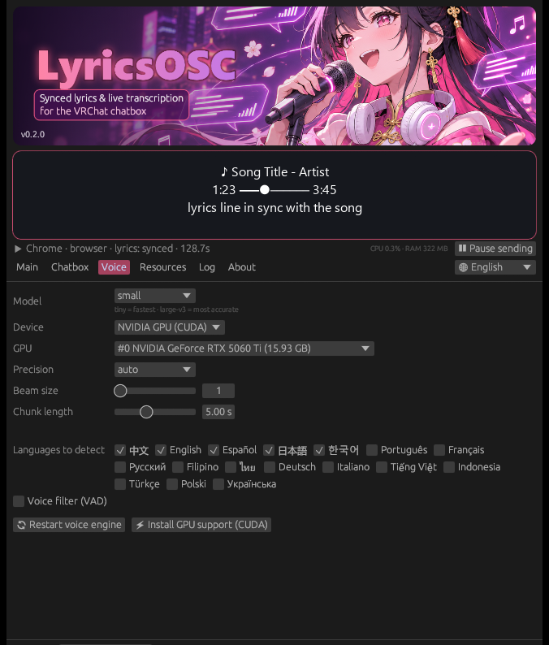
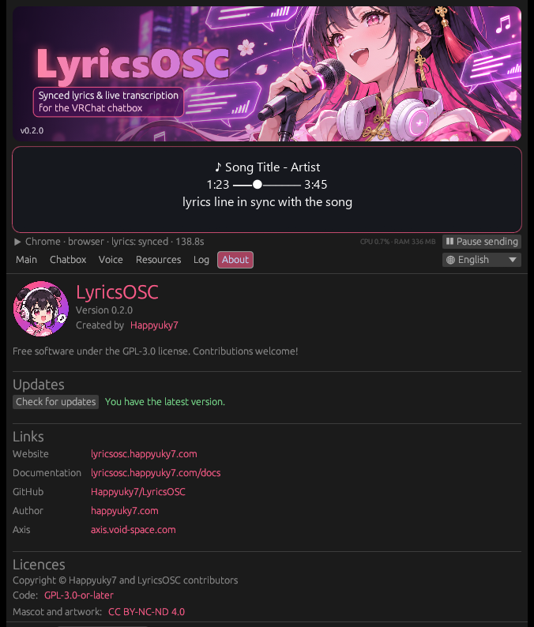
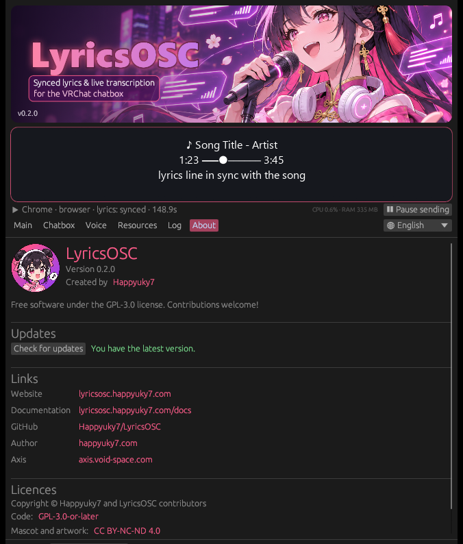

<div align="center">


# LyricsOSC

**Your song, word by word, in the VRChat chatbox.**

Synced lyrics and live AI transcription for whatever you're listening to — Spotify, YouTube or any player.

[](https://github.com/Happyuky7/LyricsOSC/releases)
[](LICENSE)
[](#download)
[](https://www.rust-lang.org)
[](https://github.com/SYSTRAN/faster-whisper)
[](https://docs.vrchat.com/docs/osc-overview)
[](#languages)

[**Website**](https://lyricsosc.happyuky7.com) · [**Download**](https://lyricsosc.happyuky7.com/download) · [**Documentation**](https://lyricsosc.happyuky7.com/docs) · [**Author's website**](https://happyuky7.com/) · [**Official repository**](https://github.com/Happyuky7/LyricsOSC)

</div>

---

## What is this?

LyricsOSC is a small desktop app that watches what you're playing and writes it in your **VRChat chatbox**: the song title, a progress bar and the current lyric line, in sync with the music.

```
♪ Song Title - Artist
1:23 ━━━●────── 3:45
lyrics line in sync with the song
```

It finds **synced lyrics online** ([LRCLIB](https://lrclib.net)). When a song has none — a live stream, a cover, a remix — it **listens** and transcribes the song with an AI voice engine ([faster-whisper](https://github.com/SYSTRAN/faster-whisper)) on your GPU. It can also work as an addon for **[Axis](https://axis.void-space.com/)**.

| Main window | Voice engine & GPU |
|---|---|
|  |  |

| Resource monitor | About & updates |
|---|---|
|  |  |

## Features

- **Any player.** Spotify, YouTube, YouTube Music, Spotify Web and SoundCloud in any browser, plus any app that uses the system media controls (Windows SMTC, Linux MPRIS).
- **Synced lyrics.** Time-synced lyrics from LRCLIB in Chinese, English, Spanish, Japanese, Korean and many more languages. YouTube titles like *"Artist - Song (Official Video) [4K]"* are cleaned up automatically. Lyrics are cached on disk, so each song is looked up only once.
- **No lyrics? It listens.** The voice engine transcribes the song live and detects its language.
- **Per-app audio, like OBS.** Transcribe only Chrome, only Spotify, an output device or a microphone. Works in incognito windows, and other apps don't interfere.
- **GPU accelerated.** Pick your NVIDIA GPU, the Whisper model (tiny → large-v3) and the precision. It falls back to the CPU automatically.
- **Axis addon.** With Axis enabled, the text goes through Axis, which writes the chatbox for you.
- **Your format.** Title template with `{title}` `{artist}` `{album}` `{app}`, progress bar, next line, text when paused, typing indicator, message interval.
- **Resource monitor.** CPU, RAM and VRAM used by the app and the voice engine.
- **Updates.** The About tab checks for new versions and links to the download page.
- **18 languages** for the interface (see [Languages](#languages)).
- **Easy installers.** The Windows and Linux installers set up the voice engine by themselves (Python, Whisper and CUDA if you have an NVIDIA GPU) inside the folder you choose. Nothing is installed system-wide.

## Download

Get the latest version from **[lyricsosc.happyuky7.com/download](https://lyricsosc.happyuky7.com/download)** or the [Releases](https://github.com/Happyuky7/LyricsOSC/releases) page.

| File | System | When to use it |
|---|---|---|
| `LyricsOSC-x.y.z-setup.exe` | Windows 10/11 | **Recommended.** Wizard where you choose the install folder |
| `LyricsOSC-x.y.z.msi` | Windows 10/11 | Managed PCs / Group Policy |
| `LyricsOSC-x.y.z-windows-portable.zip` | Windows 10/11 | No install. Run `scripts\setup_voice.ps1` once for the voice engine |
| `LyricsOSC-x.y.z-linux-x86_64.tar.gz` | Linux x86_64 | Run `./install.sh`. Needs PipeWire or PulseAudio |

## Install

### Windows

1. Run `LyricsOSC-x.y.z-setup.exe` and choose a folder (no admin rights needed).
2. At the end, the installer sets up the **voice engine** by itself: a private Python, faster-whisper and the Whisper model, all inside that folder. If it finds an NVIDIA GPU, it also installs CUDA (~1 GB more).
3. Launch **LyricsOSC** from the Start menu.

Skipped the voice engine? Open the **Voice** tab and press **Install voice engine**.

### Linux

```bash
tar -xzf LyricsOSC-x.y.z-linux-x86_64.tar.gz
cd LyricsOSC-x.y.z
./install.sh            # asks for the install folder, then offers the voice engine
```

For audio capture you need `pactl` and `parec` (packages `pulseaudio-utils` or `pipewire-pulse`). The installer adds a menu entry and an `uninstall.sh`.

### Turn on OSC in VRChat

Action menu → **Options → OSC → Enabled**. That's it: play a song.

## How it works

```
 Player (Spotify, browser…)        LRCLIB                 VRChat
          │                          ▲                      ▲
          ▼                          │ synced lyrics        │ OSC /chatbox/input
 ┌──────────────────────── LyricsOSC (Rust) ────────────────┴───┐
 │  media: SMTC / MPRIS ─► lyrics ─► chatbox text ─► OSC  or Axis │
 │                  │ no lyrics?                                 │
 │                  ▼                                            │
 │  audio capture (WASAPI / PipeWire) ──PCM──► voice engine (Python, faster-whisper) │
 └───────────────────────────────────────────────────────────────┘
```

| Part | Language | Role |
|---|---|---|
| `app/src/` | Rust | Window (egui), player detection, lyrics, audio capture, OSC, Axis, resource monitor, updates |
| `app/python/whisper_sidecar.py` | Python | Speech to text only. Receives 16 kHz audio on stdin, returns JSON lines on stdout |

## Modes

| Mode | What it does |
|---|---|
| **Auto** (default) | Online lyrics; if a song has none, transcribe the audio |
| **Online lyrics only** | Never uses the voice engine (lowest resource use) |
| **Transcribe audio only** | Always transcribes (live streams, covers, karaoke) |

## Axis addon mode

LyricsOSC works as an addon for **[Axis](https://axis.void-space.com/)** (Windows):

1. In Axis, enable the **Open API** in its settings.
2. In LyricsOSC go to **Chatbox → Axis** and tick **Send to Axis (addon mode)**.
3. `AxisOpenApi.dll` must sit next to `LyricsOSC.exe` (or set its path in the *DLL* field). It comes with Axis.

While addon mode is on, LyricsOSC **stops sending OSC itself**: the text goes through Axis, and Axis writes the VRChat chatbox. Axis receives exactly the text LyricsOSC would send (same options, same 144-character limit). Full guide: [docs/axis-addon](https://lyricsosc.happyuky7.com/docs/axis-addon).

## Settings

Everything is stored in **`config.json`** in the install folder (or `%APPDATA%\LyricsOSC` / `~/.config/lyricsosc` if that folder isn't writable). Changes apply immediately; press **Save** to keep them, or **Restore defaults** to reset everything except the interface language.

## Languages

English · Español · 简体中文 · 繁體中文 · 日本語 · 한국어 · Português (Brasil) · Français · Русский · Filipino · ไทย · Deutsch · Italiano · Tiếng Việt · Bahasa Indonesia · Türkçe · Polski · Українська

Translations live in [`app/locales/`](app/locales). Improvements from native speakers are very welcome — see [CONTRIBUTING.md](CONTRIBUTING.md).

## Project structure

```
LyricsOSC/
├── app/                    Desktop app
│   ├── src/                Rust source (egui UI, engine, media, audio, OSC, Axis, i18n, updates)
│   ├── python/             Voice engine (faster-whisper sidecar)
│   ├── locales/            UI translations (18 languages)
│   ├── assets/             Logo, icons, banner, artwork sources
│   ├── installer/          Inno Setup (.exe), WiX (.msi), Linux install.sh
│   ├── scripts/            Voice-engine setup, release builds
│   └── tools/              Asset and translation generators
├── docs/                   Banner, key art, screenshots
└── .github/workflows/      CI: builds Windows + Linux packages, publishes releases on tags
```

## Build from source

### Desktop app

You need **[Rust](https://rustup.rs) (stable)**. For the voice engine, **Python 3.12** is downloaded automatically by the setup script (via [uv](https://github.com/astral-sh/uv)).

```bash
git clone https://github.com/Happyuky7/LyricsOSC.git
cd LyricsOSC/app
cargo build --release          # → target/release/lyricsosc(.exe)
cargo test --release           # title cleanup, OSC encoding, translations, versions

# Voice engine for development (installs into the current folder)
powershell -ExecutionPolicy Bypass -File scripts/setup_voice.ps1 -InstallDir .   # Windows
./scripts/setup_voice.sh .                                                       # Linux
```

### Release packages

```bash
# Windows: portable .zip + setup .exe (Inno Setup 6) + .msi (WiX 5, if installed)
powershell -ExecutionPolicy Bypass -File scripts/build_release.ps1

# Linux .tar.gz: on Linux…
./scripts/build_linux.sh
# …or from Windows/macOS with Docker
./scripts/build_linux_docker.sh
```

Everything ends up in `app/dist/`. Pushing a tag like `v1.0.0` makes the [CI](.github/workflows/build.yml) build all packages and publish a GitHub release.

## Contributing

* Feel free to open a PR! Code, translations, bug reports and art are all welcome.
* Read [CONTRIBUTING.md](CONTRIBUTING.md) for the code layout and how to add a translation.
* Contributions require accepting the [CLA](CLA.md), so the project can also be published on stores such as Steam while the source code stays GPL.

## Additional information

[My website](https://happyuky7.com), my website.

[LyricsOSC website](https://lyricsosc.happyuky7.com), downloads and documentation.

[Axis](https://axis.void-space.com/), get Axis to use LyricsOSC as an addon.

## Contributors

- [**Happyuky7**](https://github.com/Happyuky7) - Main Developer and Maintainer.

## License

| What | Licence |
|---|---|
| **Source code** | [GPL-3.0-or-later](LICENSE) |
| **Mascot character and artwork** (`app/assets/`, `docs/`) | [CC BY-NC-ND 4.0 + reserved rights](app/assets/LICENSE-ART.md) |

**Code:** you can use, study, share and modify LyricsOSC. If you distribute a modified version, it must stay under the GPL, with its source code available and the original credits kept. Nobody can turn it into a closed product.

**Mascot:** she isn't part of the GPL. You can share the images unmodified and non-commercially, with credit. Commercial use, modified versions of the character, or using her as the identity of another project need permission. Forks distributed under another name must use their own artwork.

Third-party components: [THIRD_PARTY_NOTICES.md](THIRD_PARTY_NOTICES.md). Lyrics are provided by [LRCLIB](https://lrclib.net) and belong to their respective rights holders. LyricsOSC is not affiliated with VRChat Inc., Spotify, Google or the Axis developers.

---

© Copyright Happyuky7 2026 · Code under GPL-3.0-or-later · Artwork rights reserved

## Special Thanks To

[LRCLIB](https://lrclib.net), the free synced-lyrics database that makes this possible.

[faster-whisper](https://github.com/SYSTRAN/faster-whisper) and [CTranslate2](https://github.com/OpenNMT/CTranslate2), fast Whisper transcription.

[egui](https://github.com/emilk/egui), the Rust GUI library behind the app.

[Axis](https://axis.void-space.com/), for the addon API.
